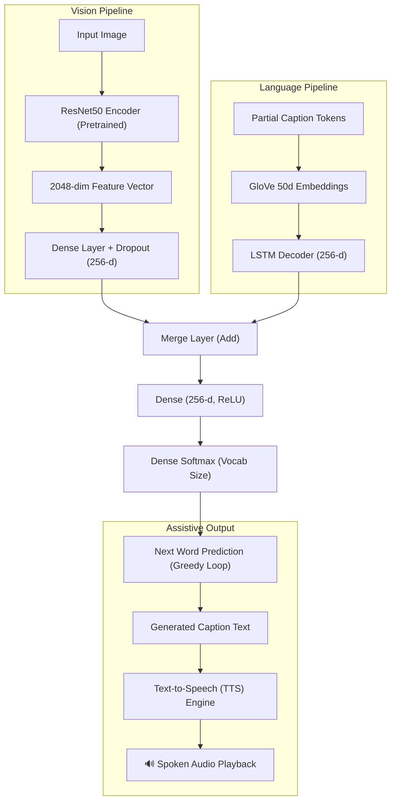

<div align="center">

# 👁️ Caption Bot for Assistive Vision

**An AI-powered assistive vision system that generates natural language image descriptions and synthesizes spoken audio for visually impaired users.**

[](https://www.python.org/)
[](https://www.tensorflow.org/)
[](https://gradio.app/)
[](LICENSE)
[]()

[Key Features](#-key-features) •
[System Architecture](#-system-architecture) •
[Interactive Web App](#-interactive-web-app) •
[Quickstart](#-quickstart) •
[Training](#-training-the-model) •
[Project Structure](#-project-structure)

</div>

---

## 📌 Overview

**Caption Bot for Assistive Vision** bridges the gap between computer vision and accessibility. While traditional image captioning models output plain text on a screen, this project is designed from the ground up for assistive scenarios:
1. **Visual Perception**: Extracts high-level visual features from real-world scenes using a convolutional neural network (**ResNet50**).
2. **Language Generation**: Synthesizes fluent, context-aware descriptions using a recurrent language model (**LSTM**) conditioned on **GloVe** word embeddings.
3. **Assistive Voice Output**: Instantly converts the generated caption into spoken audio via **Text-to-Speech (TTS)**, allowing visually impaired users to hear their surroundings described in real time.

---

## ✨ Key Features

- **Dual-Stream Encoder-Decoder Architecture**:
  - **Vision Encoder**: Pretrained **ResNet50** on ImageNet strips the top classification head to output dense 2048-dimensional feature vectors.
  - **Language Decoder**: GloVe 50d word vector initialization feeding an LSTM sequence decoder with dropout regularization.
- **Assistive Voice Engine**: Integrated TTS generator converts predictions into immediate audio playback for accessibility.
- **Interactive Gradio Interface**: Upload images from disk, clipboard, or live webcam to get instant text captions and spoken audio.
- **Production-Ready & Modular**: Clean separation of configuration, feature extraction, dataset generators, inference pipelines, and CLI commands.

---

## 🏗️ System Architecture



---

## 🚀 Quickstart

### 1. Clone the Repository & Install Dependencies

```bash
git clone https://github.com/s-ishaan/Caption-Bot-for-Assistive-Vision.git
cd Caption-Bot-for-Assistive-Vision
pip install -r requirements.txt
```

### 2. Launch the Interactive Web App

Run the Gradio application locally:

```bash
python app.py
```

Open `http://localhost:7860` in your browser. You can drag and drop an image or use your webcam to capture a scene, generate a description, and listen to the assistive audio output.

### 3. Run Inference via Command Line

Generate a caption for any image directly from the terminal with assistive speech synthesis:

```bash
python predict.py --image path/to/sample.jpg --tts --audio_out caption.mp3
```

**Options:**
- `--image`, `-i`: Path to the input image file (*required*).
- `--weights`, `-w`: Path to custom model weights (default: `saved_models/model_final.weights.h5`).
- `--vocab`, `-v`: Path to vocabulary metadata file (default: `vocab.pkl`).
- `--tts`: Enable text-to-speech synthesis.
- `--audio_out`: Destination path for the generated MP3 file.

---

## 🏋️ Training the Model

### 1. Download Required Datasets & Embeddings

1. **Flickr8k Dataset**:
   - Download the Flickr8k images and token files from [Kaggle](https://www.kaggle.com/datasets/adityajn105/flickr8k).
   - Place images in `Images/` and annotations in `Flickr_TextData/`.
2. **GloVe Embeddings**:
   - Download [GloVe 6B 50d](https://nlp.stanford.edu/projects/glove/) and place `glove.6B.50d.txt` in the root project folder.

### 2. Run the Training Script

Execute the training pipeline with configurable hyperparameters:

```bash
python train.py --epochs 30 --batch_size 64
```

**Training Pipeline Steps:**
1. Parses and cleans captions (`Flickr8k.token.txt`), stripping non-alphabetic characters and formatting start/end markers (`<s> ... <e>`).
2. Builds and serializes the vocabulary dictionary (`vocab.pkl`) based on word frequencies.
3. Extracts and caches ResNet50 visual feature vectors (`encoded_train_features.pkl` & `encoded_test_features.pkl`).
4. Initializes the embedding layer using GloVe weights.
5. Trains the model using an on-demand batch data generator and saves checkpoints per epoch to `saved_models/`.

---

## 📂 Project Structure

```text
Caption-Bot-for-Assistive-Vision/
├── src/
│   ├── __init__.py
│   ├── config.py           # Centralized configuration, paths, and hyperparameters
│   ├── preprocess.py       # Caption cleaning, vocab construction, tokenization
│   ├── encoder.py          # ResNet50 visual feature extractor
│   ├── model.py            # Model architecture & GloVe embedding matrix setup
│   ├── dataset.py          # Data generator yielding padded batches
│   ├── inference.py        # Greedy caption generation logic
│   └── tts.py              # Text-to-Speech audio synthesizer for assistive vision
├── app.py                  # Interactive Gradio web interface with audio playback
├── predict.py              # CLI tool for single-image captioning & speech generation
├── train.py                # End-to-end training pipeline entrypoint
├── requirements.txt        # Python package dependencies
├── .gitignore              # Ignores large weights, checkpoints, pickles, and datasets
└── README.md               # Documentation and architectural guide
```

---

## 🎯 Model Hyperparameters

| Parameter | Default Value | Description |
| :--- | :--- | :--- |
| **Input Image Resolution** | $224 \times 224 \times 3$ | Standard input size for ResNet50 |
| **Feature Extraction Vector** | $2048$ | Output of penultimate ResNet50 layer |
| **Word Embedding Dimension** | $50$ | Pretrained GloVe 6B vector dimension |
| **Dense Projection Units** | $256$ | Hidden layer representation size |
| **LSTM Units** | $256$ | Hidden state size of language sequence model |
| **Dropout Rate** | $0.5$ | Regularization applied to image and text streams |
| **Vocab Frequency Cutoff** | $> 10$ occurrences | Words occurring $\le 10$ times filtered out |
| **Optimizer** | Adam ($\text{lr} = 0.001$) | Standard adaptive gradient descent |
| **Loss Function** | Categorical Crossentropy | Multi-class token classification loss |

---

## ⚠️ Known Limitations & Future Improvements

The included pre-trained model was trained on **Google Colab's free tier** with limited GPU availability, which constrained both training duration and batch size. As a result, generated captions may sometimes be repetitive, generic, or miss finer details in complex scenes. This is a limitation of the training compute, not the architecture itself.

**Potential improvements with better hardware / more time:**

| Area | Current | Potential Upgrade |
| :--- | :--- | :--- |
| **Training Data** | Flickr8k (8,000 images) | Flickr30k or MS COCO (330k images) |
| **Encoder** | ResNet50 | Vision Transformer (ViT) or EfficientNet-B7 |
| **Embeddings** | GloVe 50d (frozen) | GloVe 300d or trainable embeddings |
| **Decoding Strategy** | Greedy (argmax) | Beam Search (k = 3–5) |
| **Evaluation** | Manual inspection | BLEU-4, METEOR, CIDEr scoring |
| **Training Epochs** | 30 (small batch) | 50+ with larger batches and learning rate scheduling |

---

## 🤝 Contributing

Contributions are welcome! If you'd like to improve model performance, add Beam Search, or extend multilingual speech support:
1. Fork the Project
2. Create your Feature Branch (`git checkout -b feature/AmazingFeature`)
3. Commit your Changes (`git commit -m 'Add some AmazingFeature'`)
4. Push to the Branch (`git push origin feature/AmazingFeature`)
5. Open a Pull Request

---

## 📄 License

Distributed under the MIT License. See [`LICENSE`](LICENSE) for more information.
